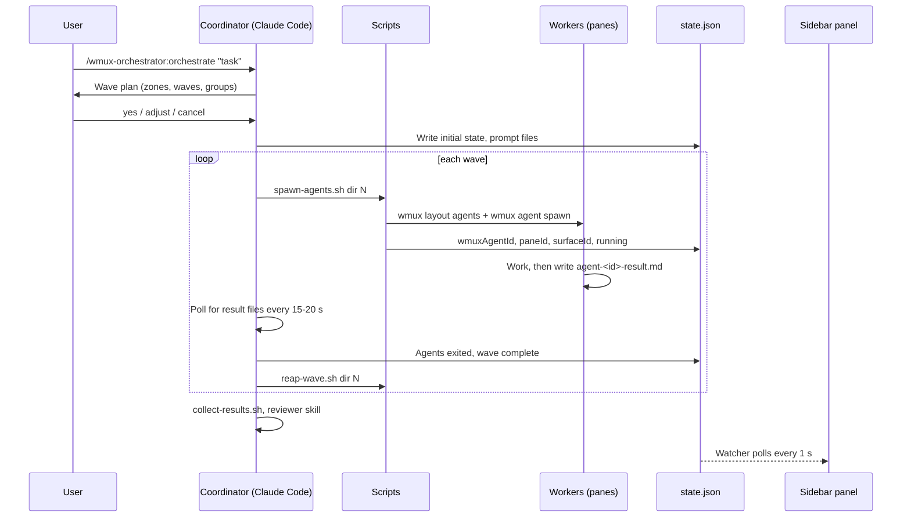

# Legacy orchestrator: how it worked and what to keep

remotea inherited wmux's orchestrator, a Claude Code plugin called `wmux-orchestrator`. It split a task across several Claude Code agents running in visible panes, in waves, and finished with a reviewer. wmux deprecated it in 2.12.0 (#239). A later remotea PR deletes the code.

This note records the design so a future remotea orchestrator can reuse what worked. It describes the code as it stands, not as its README claims. Where the two disagree, the note says so.

## Sources

Every path below is pinned to `origin/main` at **74f1b92**. Read any of them after deletion with `git show 74f1b92:<path>`.

| Source | What it holds |
|---|---|
| `resources/wmux-orchestrator/README.md` | User-facing overview |
| `resources/wmux-orchestrator/skills/orchestrate/SKILL.md` | The coordinator's instructions, Phases 0 to 9 |
| `resources/wmux-orchestrator/skills/orchestrate/references/decomposition-guide.md` | Split patterns, coupling rules, pane groups |
| `resources/wmux-orchestrator/skills/reviewer/SKILL.md` | The final reviewer |
| `resources/wmux-orchestrator/agents/wmux-worker.md` | Worker agent definition |
| `resources/wmux-orchestrator/hooks/hooks.json` | Hook registrations |
| `resources/wmux-orchestrator/scripts/*.sh`, `json-tool.js`, `launch-agent.js` | State helpers, spawn, reap, hooks |
| `docs/superpowers/specs/2026-04-07-wmux-orchestrator-plugin-design.md` | Original design (April 2026) |
| `docs/superpowers/plans/2026-04-07-wmux-orchestrator-plugin.md` | Original implementation plan |
| `src/shared/types.ts`, lines 1051-1103 | `OrchestrationState` and related types |
| `src/main/orchestration-watcher.ts` | Main-process poller for `state.json` |
| `src/renderer/components/Sidebar/OrchestrationPanel.tsx` | Sidebar panel |
| `AGENTS.md`, section "wmux-orchestrator Plugin" | Deprecation reason |

Section 9 also cites `src/main/agent-manager.ts`, `src/renderer/store/agent-rollup.ts`, `docs/remotea/tea.md` and `docs/remotea/plan.md` at the same sha. Commits cited below (`c234655`, `ad8dad8`, `8c9db13`, `b3997c2`, `9fc9228`, `d096033`) are all reachable from 74f1b92.

## The flow at a glance

The spec and README describe hooks driving the waves. The code that shipped in wmux mode works differently: the coordinator model drives every transition itself, by polling for result files. The diagram shows the shipped wmux-mode flow.

## 1. Planning

`skills/orchestrate/SKILL.md` runs the plan in Phases 2 to 5.

- **Analyse.** Map the relevant files with Glob and Grep, trace imports, find "conflict zones" (files more than one subtask would touch), read recent commits.
- **Decompose.** Each subtask gets a 2-3 sentence scope, an allowed-files list and an excluded-files list. Tightly coupled files stay together. Shared types go first, tests last. One-subtask or one-line tasks skip orchestration entirely.
- **Patterns.** `decomposition-guide.md` offers four splits: layer-based, feature-based, component-based and migration. It sizes runs at 2-5 agents and says more than 5 should be separate orchestrations.
- **Coupling check (Phase 4.5).** Parallel agents that must agree on names drift apart. The skill cites a real run where HTML and CSS agents invented `.hero__grid` and `.hero__inner` for the same element, and 510 lines of alias CSS fixed it afterwards. For each coupled group the coordinator picks one fix: merge into one agent (under about 800 lines of output), sequence across waves, or write a shared contract at `{orch-dir}/wave-{N}-contract.md`. The guide insists the contract is one file on disk that every coupled agent reads, not a list pasted into each prompt.
- **Pane groups.** Agents of one wave may share a pane as tabs via a `group` name. This affects layout only.
- **Approval.** The coordinator shows the plan and waits for "yes / adjust / cancel". It does not proceed without an explicit yes.

## 2. File zones

Each worker's prompt file (`agent-<id>-prompt.md`, template in SKILL.md Phase 6c) lists "Allowed files (you MAY modify these)" and "Excluded files (you MUST NOT modify these)". `agents/wmux-worker.md` adds: stop and report under "Risks" if a change is needed outside the zone, never `git commit` or `git push`.

**Enforcement was prompt-only.** The spec lists "File zones are advisory (prompt-based, not enforced)" as a known V1 limitation and puts "Enforced filesystem sandboxing" out of scope. Three gaps follow from the code:

- In wmux mode a worker is a plain `claude` process started by `launch-agent.js` with the prompt file as its argument. It does not load `wmux-worker.md`. The Phase 6c template carries the zone lists and the result format, but not the worker file's "no git commit" rule.
- The reviewer reads `git diff` but has no step that compares changed files against each agent's zone.
- The `--worktree` option appears in the README, in the Phase 5 plan text and as `useWorktrees` in the state schema. No script reads it. Worktree isolation was never built.

## 3. Waves

A wave is a set of agents that run in parallel. Waves run one after another. Wave 1 holds foundations (types, interfaces), later waves build on it, and the last wave holds tests or docs.

**Ordering is linear.** Each wave in `state.json` has a `blockedBy` array, but no script reads it. `json-tool.js` query `next-pending-wave` returns the first wave whose status is `pending`, in array order. The spec admits "Wave dependencies are linear (wave N blocks wave N+1)".

**Hand-off between waves** (SKILL.md Phase 7, wmux mode):

1. A worker is done when `agent-<id>-result.md` exists. Process exit is not the signal: workers run Claude's interactive TUI and never exit, so `wmux agent list` reports them `running` forever.
2. When every agent in the wave has a result file, the coordinator reads them, sets each agent to `exited` and the wave to `complete` with `update_agent` and `update_state`, then runs `reap-wave.sh <dir> <N>`.
3. It writes the next wave's prompt files, pasting the earlier results into a "Previous Wave Results" section. This is the result chaining the README describes.
4. It runs `spawn-agents.sh <dir> <N+1>`.

`spawn-agents.sh` first reaps all earlier waves, then calls `wmux layout agents --count <cells>`. That splits only the coordinator's pane: the coordinator keeps a 40% column on the left and workers get a grid on the right, one cell per group or ungrouped agent. It then runs `wmux agent spawn --cmd "node launch-agent.js <prompt>" --pane <cell>` per agent. The first agent in a cell uses `--replace-tab`, so it replaces the idle shell tab, and the others join as tabs. A CLI spawn timeout is rechecked against `wmux agent list` so a late-starting agent still gets recorded and reaped.

`reap-wave.sh` runs `wmux agent kill`, then `wmux close-surface`, and stamps `reapedAt`. It is idempotent. It never closes the caller's surface, the coordinator's surface, or anything in the coordinator's pane. A failed close is left unstamped so the next reap retries it (`d096033`).

To steer a running worker, the skill says to write the instruction to a file and run `wmux send --surface <workerSurfaceId>`. Without `--surface`, the text lands in the coordinator's own session.

**Failures.** The spec promised retry, skip or abort on a failed agent. The shipped `wave-complete` query treats `failed` the same as `exited`, so a failed agent completes its wave like any other.

## 4. Hooks and hand-offs

`hooks/hooks.json` registers four hooks. The plugin never loaded (section 8), so none of them ever ran from the bundled copy. They are described here as written.

| Hook | Script | What it does |
|---|---|---|
| `PostToolUse` (Bash, Read, Write, Edit, Grep, Glob, Agent) | `on-tool-use.sh` | Exits at once unless `WMUX_AGENT_ID` is set. Otherwise finds the run, increments that agent's `toolUses` and refreshes the markdown dashboard. |
| `SubagentStop` | `on-agent-stop.sh` | Marks the agent `exited` or `failed`. If its wave is complete, either sets `reviewer.status` to `ready` or marks the next pending wave `running` and calls `spawn-agents.sh` for it. |
| `Stop` | `on-stop.sh` | Warns if agents are still running. Reaps any `complete`, unreaped run whose recorded coordinator is this pane. Leaves `failed` and `aborted` runs alone. |
| `SessionStart` | `on-session-start.sh` | Prints any run still marked `running` as "interrupted". That is all the "crash recovery" does. |

The design leaned on `SubagentStop` as the core wave trigger. It could not work in wmux mode, and probably not in degraded mode either:

- `SubagentStop` fires only for Claude Code's native subagents. Workers spawned by `wmux agent spawn` are separate processes. `c234655` found this, and the header of `on-agent-stop.sh` now says so. That is why the skill switched to polling result files.
- Both scripts identify the agent by `WMUX_AGENT_ID`. `AgentManager.spawn` in `src/main/agent-manager.ts` sets that variable to `agent-<uuid>`. `state.json` uses bare ids such as `a`, and `findAgent` in `json-tool.js` compares `.id` only, so the lookup would not match. Native subagents get no such variable at all. This is my reading of the code. No source states it.
- Even if it had fired, the hook spawns the next wave without writing its prompt files. Those files, with the earlier results pasted in, are written by the coordinator model.

`ad8dad8` (#99) fixed the hook writing `completed` where the app counts `exited` and `complete`. Its message says degraded-mode runs "sat at 0/N forever", so someone ran degraded mode. The sources do not show whether its transitions ever fired.

The markdown dashboard path is also dead. Hooks push to `dashboardSurfaceId`, but nothing in the skill or scripts ever sets it. The sidebar panel replaced it.

## 5. The final reviewer

After the last wave, the coordinator runs `collect-results.sh` to build one summary, then invokes `skills/reviewer/SKILL.md`. The spec had the reviewer in its own pane. The shipped skill runs it as a skill call inside the coordinator's own session.

The reviewer:

1. Reads all results and `state.json`.
2. Reads `git diff` and `git diff --stat`, and checks each changed file for syntax errors and broken imports.
3. Checks consistency across agents: types match across boundaries, imports resolve, no orphaned exports, no duplicate implementations.
4. Runs `npm test`.
5. Fixes small things itself: missing imports, type mismatches at agent boundaries, minor syntax. It may not rewrite logic, change the architecture or add features.
6. Writes `review-report.md` ending in READY TO COMMIT, NEEDS USER REVIEW or SIGNIFICANT ISSUES FOUND, and offers commit, view diff or abort.

The reviewer skill has defects that show it was never run end to end as written:

- Step 1 finds the run with `find_active_orch`, which returns only runs whose status is `running`. Phase 7 of the orchestrate skill marks the run `complete` before Phase 8 starts the reviewer.
- Step 7 calls `update_state "$ORCH_DIR" '.reviewer.status = "completed"'`. That passes a jq-style expression as the path and no value, so `setPath` writes a junk key instead of setting the status. `completed` is also the word #99 removed everywhere else.
- Phase 4.5 tells agents that the reviewer will reconcile any `contract_disagreement` "before the next wave". The reviewer runs only after the last wave.

## 6. The state file

**Location.** `${TMPDIR:-/tmp}/wmux-orch-<id>/state.json`. `<id>` is `orch-` plus the last six digits of the Unix time. On Windows Git Bash, `TMPDIR` is often unset, so the skill has the coordinator export it to `%LOCALAPPDATA%\Temp` first. Otherwise the scripts write to `/tmp` and the app, which watches Node's `os.tmpdir()`, never sees the run.

**Shape.** `OrchestrationState` in `src/shared/types.ts` mirrors the skill's schema:

- Run: `id`, `task`, `status`, `startedAt`, `cwd`, `workspaceId`, `dashboardSurfaceId`, `useWorktrees`, `waves[]`, `reviewer`.
- Wave: `index`, `status`, `blockedBy`, `agents[]`.
- Agent: `id`, `label`, `group`, `subtask`, `files`, `excludeFiles`, `paneId`, `surfaceId`, `status`, `exitCode`, `toolUses`, `resultFile`, `startedAt`, `finishedAt`.
- Vocabulary: agents `pending | running | exited | failed`; waves and runs `pending | running | complete | failed`. The skill also uses `aborted`, which the types lack.

The scripts write fields the types leave out: `wmuxAgentId` and `reapedAt` on agents, and `coordinatorPaneId`, `coordinatorSurfaceId` and `reapedAt` on the run. Next to `state.json` the directory holds `agent-<id>-prompt.md`, `agent-<id>-result.md`, `wave-<N>-contract.md`, `review-report.md` and `state.lock`. The reviewer looks for an `all-results.md` there, but `collect-results.sh` prints to stdout and nothing writes that file.

**Writers.** At least five writers share the file: the coordinator through its Write tool and the state helpers, `spawn-agents.sh`, `reap-wave.sh`, the hooks, and the reviewer. `acquire_lock` in `orchestration-state.sh` waits up to 2 seconds for `state.lock`, then writes its own PID and goes ahead regardless. The skill warns that on Windows, reads can race the app's poller and should be retried.

**Lifecycle.**

1. The coordinator creates it after approval, with wave 0 `running` and the rest `pending`.
2. Spawn, coordinator and reap writes move agents and waves along (section 3).
3. The coordinator marks the run `complete`, or `aborted` to give up.
4. The `Stop` hook or `reap-wave.sh <dir> all` closes the panes of a `complete` run.
5. Only `cleanup.sh` deletes the directory. A `failed` or `aborted` run's panes and files stay until someone runs it.

## 7. The sidebar panel

`startOrchestrationWatcher` (called from `src/main/index.ts`) runs `tick` every 1000 ms. Each tick lists `wmux-orch-*` directories in `os.tmpdir()` and parses each `state.json`. `isValidState` rejects anything without a string `id`, a string `status` and an array `waves` whose entries have a numeric `index` and an `agents` array. The comment explains why: one malformed file once crashed the renderer into a black window.

It shows **one run at a time**. A `running` run beats a finished one, and between equals the newest mtime wins. A finished run lingers for 30 s (`COMPLETE_LINGER_MS`) from when the watcher first saw it finish. The watcher sends `orchestration:update` only when the shown run, its mtime or its status changes, and sends `orchestration:clear` when nothing is left. It never writes. `AGENTS.md` notes it "does not care who wrote it", which is why it survived the deprecation.

`OrchestrationPanel` (rendered in `Sidebar.tsx`) hides when there is no run. Its header, titled "Legacy local orchestration", collapses the panel and shows the status and short id. The body shows:

- the task, an elapsed clock (ticking each second while running), "wave X/Y", "N/M done" (counting `exited` only) and a running count;
- per wave, a progress bar counting `exited` and `failed`, and agent cards (status dot, label, `↦` tool-use count, duration, or "waiting" when pending). Grouped agents sit under a header with a done/total count, built by `groupWaveAgents` in `orchestration-groups.ts`;
- a reviewer row once the reviewer is no longer `pending`;
- a dismiss button for `complete` or `failed` runs. It only clears the renderer store (`clearOrchestration`), and an `aborted` run gets no button.

Because hooks never ran, `toolUses` stayed at 0 unless something else wrote it.

## 8. Why it was deprecated: it never loaded

From the "wmux-orchestrator Plugin" section of `AGENTS.md` at 74f1b92: wmux's `ensurePluginRegistered()` wrote Claude Code's `installed_plugins.json` as a top-level object. That file is version 2, `{version:2, plugins:{"<plugin>@<marketplace>":[…]}}`, and its cache path is `cache/<marketplace>/<plugin>/<version>`, not wmux's `cache/<plugin>/<version>`. So Claude Code listed nothing, loaded no skill, command or hook, and marked the copied tree `.orphaned_at`. Meanwhile `enabledPlugins` said `true` and wmux logged a successful install.

The supported fix was a local marketplace. wmux judged it not worth doing "because Claude Code now runs parallel agents natively". wmux 2.12.0 stopped installing the plugin and removes old installs.

The original plan's end-to-end check (Task 11, Step 2) looked for `installed_plugins.json | jq '.["wmux-orchestrator@wmux"]'` at the top level. That checks the wrong shape, so it passed against the broken install.

The plugin still ran for some people. `8c9db13` describes the bundled skills as a "byte-for-byte mirror" of improvements made in the standalone `wmux-orchestrator` repo, and those improvements read like field lessons: result-file completion, bare ids, Windows `TMPDIR`. My inference is that real runs came from the standalone install, not the bundled one.

## 9. What a remotea orchestrator would keep and change

remotea already has pieces the plugin had to build or fake: an assistant (Tea, being renamed Dani, see `docs/remotea/tea.md`), an agent roster fed by each agent's own hooks (`rollupAgents` in `src/renderer/store/agent-rollup.ts`, `AgentRosterBanner.tsx`), remote hosts whose session server owns terminals, and `wmux agent spawn` and `layout agents`.

### Keep

- **Plan, then explicit approval.** The plan format (waves, allowed and excluded files, groups) gave the user one place to correct the split before any agent started.
- **The coupling rules and the on-disk contract file.** They come from a measured failure (510 lines of alias CSS). The rule that the contract is one file all agents read, not a list copied into prompts, is the most transferable lesson here.
- **The result file as both completion signal and hand-off.** Interactive agents never exit, so file presence was the signal that held up in the field. Its fixed sections (Summary, Files Modified, Interfaces/Types Changed, Tests, Risks) are what the next wave and the reviewer actually consume.
- **Visible workers in panes, laid out beside the coordinator.** `layout agents` anchored on the coordinator's pane, one cell per group, and `--replace-tab` took several fixes to get right (`b3997c2`, `9fc9228`). The user could also type into any worker, and the coordinator could steer one with `wmux send --surface`.
- **Careful reaping.** Idempotent, never closes the coordinator or caller, retries failed closes, and only the owning pane reaps (`d096033`). Failed runs keep their panes for inspection.
- **A read-only view that validates its input.** `isValidState` exists because bad input crashed the renderer.
- **Normal permission prompts by default**, with skipping them as an explicit opt-in (`launch-agent.js`, `buildClaudeArgs`).

### Change

- **Don't install into another tool's plugin system.** The orchestrator died from a config file remotea did not own, and the failure was silent. A remotea orchestrator should run in remotea's own process. Dani's server-owned tool loop is the obvious host. That placement is my proposal; no source decides it.
- **Use the roster for agent state instead of polling.** The coordinator polled `ls` every 15-20 s because `SubagentStop` never fires for pane agents. remotea already gets each worker's own hook events in the roster. A result file plus the roster's idle or waiting state is a better completion signal than either alone. This is a guess: the sources show the problem, not this fix.
- **One owner for orchestration state.** Five writers, a lock that gives up after 2 s and writes anyway, and three spellings of "done" (`completed`, `complete`, `exited`) caused #99 and the reviewer bugs above. A single owner writing a typed record would remove that class of bug. The roster and any panel would then read from it instead of polling a temp directory.
- **Key agents by the spawn's agent id.** The `WMUX_AGENT_ID` (`agent-<uuid>`) versus bare-id mismatch is why tool counts could never have updated. The id `wmux agent spawn` returns should be the join key.
- **Stop on failure.** A failed agent should halt the next wave and ask the user, as the spec intended. Today it counts as done.
- **Make zones checkable.** At minimum, compare each agent's changed files against its zone after the wave, which the reviewer never did. Per-agent worktrees were promised and never built. They would enforce zones, but they bring merge cost, and the sources hold no evidence about how that would go.
- **Run the reviewer as a fresh agent between waves as well as at the end.** The spec wanted a separate pane, and the contract-disagreement flow needs a check between waves. Running it inside the coordinator's session lost both.
- **Plan for remote hosts.** The legacy state lived in the local temp directory, and the watcher only reads `os.tmpdir()`. On a remote host the session server owns the terminals, so orchestration state has to live there too. `docs/remotea/plan.md` (item 4 under "Defaults for the plan agent's open questions") keeps CLI-spawned agents local until phase 4, so remote orchestration depends on that phase.
- **Drop degraded mode.** It doubled every path, and `c234655` shows the model drifting into it even with wmux running. remotea always has panes.
- **Be clear what the orchestrator is for.** wmux dropped the repair because Claude Code now runs parallel agents itself. Per the spec's problem statement, what native subagents lack is visibility and the ability to step in mid-run, across panes, and in remotea across hosts. Parallelism alone no longer justifies the feature.
